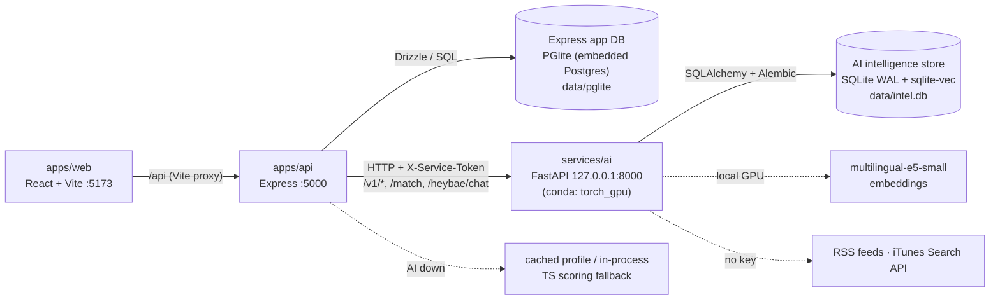

# PodBae Local (PODBAE_AI)

A localhost replica of the PodBae MVP (podbae.love) plus the AI layer being built for it, one layer at a time.
Windows, no Docker, **no API keys required**. Everything lives in `podbae-local/`.

| Layer | Status |
|---|---|
| Phase 0: MVP replica (UI, routes, `/api/*` surface) | Done |
| **Layer 1: Podcast Intelligence + Trust Spine** | Built, **hardened in Phase 1** (no LLM; rules + local embeddings). See `podbae-local/PHASE1_REPORT.md` |
| Layer 2-6 (sponsor, venue, opportunity engine, Bae agent, outcomes) | Not started |

## Architecture



Two databases, two owners:

| Store | Owner | Holds |
|---|---|---|
| **Express app DB** (`data/pglite`, PGlite) | `apps/api` | users, sessions, tiers, payments (mock), chat, swipes, matches, UI state, the link between a member's podcast and its intelligence show id (`intel_links`) |
| **AI intelligence store** (`data/intel.db`, SQLite + sqlite-vec; Postgres + pgvector in production, untested) | `services/ai` | shows, episodes, field-level provenance (source, tier, method, confidence, freshness), evidence snippets, embeddings, cost ledger, budgets, jobs, audit log, corpus calibration, human evaluation labels |

The Node API reaches intelligence **only** through the AI service's HTTP API. The AI service listens on `127.0.0.1` only, and every route except `/health` and `/v1/health` requires the header `X-Service-Token` (value `INTEL_SERVICE_TOKEN` in `.env`; Express sends it automatically).

## Layer 1 status (after Phase 1)

- **Ingestion:** RSS (conditional GET, retries, encoding repair, SSRF protection on every redirect hop), iTunes Search for discovery (no key; rate-limited about 20/min and cached). Every failed feed gets a reason code: `dns`, `timeout`, `http_4xx`, `http_5xx`, `tls`, `invalid_xml`, `empty`, `too_large`, `ssrf_blocked`, ...
- **Seed:** about 300 *independent, active* shows across 12 category groups. The definition is in `services/ai/seed/independent.yaml`: a network blocklist, a new episode within 90 days, and at least 5 episodes.
- **Understanding, with no LLM:**
  - topics from a fixed taxonomy (each needs evidence from 2 episodes, or the description + 1 episode)
  - guest detection rules
  - conversational style, with `unknown` when no rule is confident
  - vibe from corpus-calibrated embedding similarity
  - tone, values and brand-safety lexicons

  Each value records `method` = rule / model and a confidence.
- **Similarity:**
  - content: e5 embeddings
  - style: a numeric, mean-centred vector (fixes the Layer 1 problem where unrelated shows scored 0.97)
- **Identity:** a same-title merge needs a strong agreeing signal: podcast:guid, iTunes ID, the same owner (salted email hash; the raw email is never stored), the same artwork, or ≥50% shared distinctive episode GUIDs.
- **Evaluation:** human labels are collected at `/admin/labels`. Claude-written drafts are excluded from scoring.
- **Still mocked / untested:** LLM (none used), Podcast Index and Taddy (no keys), Postgres + pgvector, Whisper.

## Requirements
- Node 20+ and Python: both come from the conda env **`torch_gpu`** (run commands from a conda-activated terminal).
- Internet access for seeding and real feeds.

## Run
```powershell
conda activate torch_gpu
cd C:\Nk\PODBAE\podbae-local
copy .env.example .env      # first time only, then set INTEL_SERVICE_TOKEN to a long random string
npm run setup               # first time only: npm install + pip install + migrations + demo seed
npm run dev                 # web http://localhost:5173 · api http://localhost:5000 · ai http://127.0.0.1:8000
```
Open http://localhost:5173. Press `Ctrl+C` to stop all three servers.

Stop leftovers:
```powershell
foreach ($p in 5173,5000,8000) { Get-NetTCPConnection -LocalPort $p -State Listen -ErrorAction SilentlyContinue | % { Stop-Process -Id $_.OwningProcess -Force } }
```

## Commands (from `podbae-local/`)

| Command | What it does |
|---|---|
| `npm run dev` | start web, api and ai together |
| `npm run setup` | install deps, apply migrations (both stores), seed demo data |
| `npm run reset` | wipe the **Express** DB (`data/pglite`) and reseed demo users (stop `npm run dev` first) |
| `npm run db:generate` / `npm run db:migrate` / `npm run seed` | Express DB: new drizzle migration / apply / seed |
| `npm run intel:migrate` | apply Alembic migrations to the intelligence store |
| `npm run intel:seed` | ingest ~300 independent active shows via iTunes Search (add `-- --fresh` to archive the current store first) |
| `npm run intel:connect-demo` | connect `podcaster@podbae.local` to a real feed (needs `npm run dev`) |
| `npm run intel:eval` | write `EVAL_LAYER1.md` (human-label metrics, style similarity, dedupe, seed, coverage, costs) |
| `npm run intel:diagnose-feeds` | re-fetch the Layer 1 feed list and classify every failure |
| `npm run ui:smoke` | Playwright: log in as each role, screenshot the main pages into `screenshots/`, report console errors (needs `npm run dev`) |
| `npm test` · `npm run test:ai` | API tests (vitest) · AI-service tests (pytest) |
| `npm run typecheck` · `npm run lint` · `npm run build` | quality checks |

## Demo logins (all fake, `demo=true`)
| Email | Password | Role |
|---|---|---|
| admin@podbae.local | admin123 | admin (sees Ingestion / Coverage / Costs / Labels tabs, `/admin/labels`) |
| podcaster@podbae.local | demo123 | podcaster (flirt tier; `/intelligence`) |
| brand@podbae.local | demo123 | advertiser |

Other seeded accounts use `*@demo.podbae.local` / `demo123`.

## Reports
- `podbae-local/PHASE1_REPORT.md`: what Phase 1 changed, before/after numbers, what is still mocked, risks, and what Layer 4 can rely on.
- `podbae-local/EVAL_LAYER1.md`: the measured numbers (regenerate with `npm run intel:eval`).
- `podbae-local/LAYER1_REPORT.md`: the original Layer 1 report (historical).
- `podbae-local/TESTING_CHECKLIST.md`: the manual test list.

## Folder map (`podbae-local/`)
```
packages/contracts/     zod schemas + types shared by web and api (incl. intelligence.ts)
apps/api/               Express: routes (auth, intake, podcasts, member, social, admin, intel), services (matching, intel client, payments seam)
apps/web/src/           React pages (incl. Intelligence.tsx, Admin.tsx, AdminLabels.tsx) and components
services/ai/app/        FastAPI: main.py (+ /match, /heybae), auth.py (service token), intel/ (Layer 1)
  intel/connectors/     rss, iTunes Search, Podcast Index + Taddy (untested), failure classification
  intel/understanding/  signals.py (rules), model_signals.py (embeddings), pipeline.py, taxonomy.yaml, category_map.yaml,
                        vibes.yaml, first_names.txt, refine.py (LLM seam, disabled), extract.py (LLM path, unused in Phase 1)
  intel/trust/          provenance, budgets + cost ledger, jobs, audit, sanitiser
services/ai/seed/       independent.yaml (seed rules), feeds.txt (last seed's accepted feeds)
services/ai/scripts/    intel_seed.py, eval_layer1.py, feed_diagnose.py
scripts/                connect-demo.mjs, ui_smoke.py, open-browser.mjs
data/                   pglite/ (Express DB), intel.db (intelligence store), archive/ (previous stores)   (git-ignored)
```
