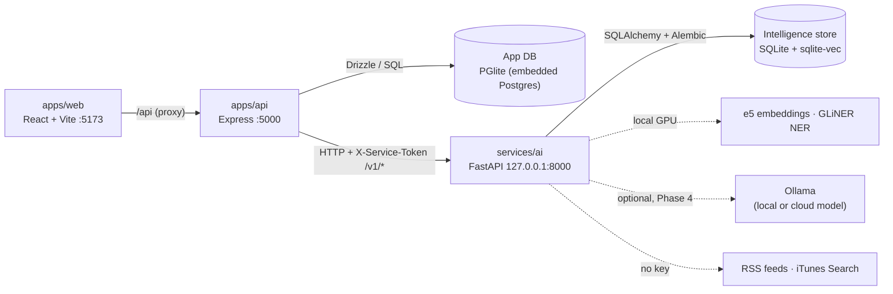

# PodBae AI

**An evidence-based matchmaking engine for independent podcasters.** PodBae finds the right partner shows and sponsors for a podcast, and explains every recommendation with evidence a creator can check.

This repository holds a local replica of the PodBae MVP ([podbae.love](https://podbae.love)) and the AI layers being built for it, one layer at a time. It runs entirely on a Windows laptop: no Docker, and no paid API keys.

> **Design principles:** trust before intelligence · business outcomes before AI complexity · sustainable economics.
> Every value the system shows has a source, a confidence and its evidence. Missing data is reported as missing, never guessed.

---

## Project status

| Phase | Layer | Status |
|---|---|---|
| Phase 0 | MVP replica: UI, routes, `/api/*` surface, tiers (Flirt / Date / Commit) | ✅ Done |
| Phase 1 | **Layer 1: Podcast Intelligence + Trust Spine** | ✅ Done |
| Phase 2 | **Layer 4: Opportunity Engine** (podcast partners) | ✅ Done |
| Phase 3 | **Layer 2: Sponsor Intelligence** + sponsor opportunities | ✅ Done |
| Phase 4 | **LLM refinement** (Ollama), only where rules were measured to be weak | 🟡 In progress: code complete and tested; the full LLM run and the report are pending |
| — | Layer 3: Venues | ⬜ Not started |
| — | Layer 5: Bae (AI agent) | ⬜ Not started |
| — | Layer 6: Outcomes / feedback loop | ⬜ Not started |

### Measured on the current data (303 real independent shows)

| Measure | Result |
|---|---|
| Shows / episodes analysed | 303 shows · 35,877 episodes · 422 transcripts |
| Partner opportunities (Layer 4) | ≥ 1 qualified match for **275 / 303** shows · ≥ 3 for 247 · honest "no good match yet" for 28 (9.2%) |
| Sponsorship evidence found (Layer 2) | 59,875 classified detections · 111 shows (36.6%) with sponsorship history |
| Brands | 988 resolved · 260 active · 57 active on 2+ shows |
| Sponsor opportunities | ≥ 1 for **282 / 303** shows · ≥ 3 for 249 · 0 explanation faithfulness problems |
| Privacy | 0 of 59,875 stored ad snippets contain an e-mail address |
| Tests | 257 Python (pytest) · 35 API (vitest) · typecheck, lint and build clean |

> **Honest note:** no human labels or reviews exist yet. All *accuracy* figures (topic, style and guest precision, sponsor-class precision, match quality) are **unmeasured**. The admin labelling and review tools to measure them are built (see [Evaluation](#evaluation)).

---

## What each layer does

### Layer 1: Podcast Intelligence + Trust Spine (Phase 1)
- **Ingestion:**
  - RSS with conditional GET, retries, encoding repair, and SSRF protection on every redirect.
  - iTunes Search for discovery (no key; rate-limited and cached).
  - Every failed feed gets a reason code (`dns`, `timeout`, `http_4xx`, `invalid_xml`, …).
- **Understanding, with no LLM:**
  - topics from a fixed taxonomy (each needs evidence from 2 texts)
  - guest detection
  - conversational style (`unknown` when no rule is confident)
  - vibe from corpus-calibrated embeddings
  - tone, values and brand-safety lexicons
- **Similarity:**
  - content embeddings (local `multilingual-e5-small` on the GPU)
  - a mean-centred numeric style vector
- **Trust Spine:**
  - field-level provenance: source, tier (verified > creator-provided > estimated > inferred), method, confidence and freshness
  - evidence snippets
  - cost ledger and budgets, background jobs, audit log
  - identity resolution with a strong-signal merge rule
- **Privacy:** an owner e-mail is stored only as a salted hash, and never returned by any API.

### Layer 4: Opportunity Engine, podcast partners (Phase 2)
- A deterministic pipeline: candidates → hard gates (each with a reason code) → Fit score → confidence → readiness → why-now → ranking.
- **Four separate measures per card:** Fit, evidence confidence, commercial status, and conversion ("Not enough data yet" until outcomes exist).
- **Missing data is never imputed:** the factor is excluded, the remaining weights are re-normalised, and confidence goes down.
- **Template explanations with a faithfulness checker:** every number in the text must come from the breakdown.
- **Tier rules:** Flirt 3 per day, Commit unlimited, never padded.
- **If the AI service is down,** the last list is served from a cache with a "may be outdated" banner.

### Layer 2: Sponsor Intelligence (Phase 3)
- **Scan:** every stored show note and transcript is classified into 8 evidence classes. Declared and likely sponsorships count as history; organic mentions, self-promotion, affiliate links and network boilerplate never do.
- **Brand names:** local zero-shot NER (GLiNER, Apache-2.0) with a rules fallback.
- **Brand resolution:** domain-first, with an offline public-suffix list. Name-only spellings are never auto-merged.
- **28 brand categories:** sensitive ones need an explicit keyword; manual overrides always win.
- **Sponsor opportunities** run on the *same* engine as partners: lookalike, momentum, category fit, recency and breadth factors, plus gates for sensitive categories, exclusivity and cooldowns.
- **"Verified"** only for a brand that is a registered PodBae advertiser, matched by website domain, never by name.
- **Admin tools:** a human review queue and a brands page (merge, split, categories, registrations).

### Phase 4: LLM refinement (in progress)
The LLM is connected **only where rules were measured to be weak**, and always as a second opinion stored *next to* the rule value.

| Refiner | Runs only when | Guard |
|---|---|---|
| Conversational style | the rule says `unknown` (44% of shows) or its confidence is < 0.5 | needs a verbatim quote that contains a format cue; otherwise stays `unknown` |
| Guest detection | the rule's guest share is 0.1–0.5, or a guest name is not in the first-name list | a verbatim quote per guest episode; names are never stored as fields |
| Extra topics | the rules found fewer than 3 topics | fixed taxonomy only; ≥ 2 verbatim quotes from 2 different texts |
| Uncertain sponsor detections | always (406 events) | the LLM alone can never create `declared_sponsorship` (it is capped to `likely`) |
| Organic-mention audit | a brand-stratified sample | promoted events are flagged for human review; reports an estimated miss rate |
| Brand categories | active brands | a verbatim quote, a local-embedding relevance check, and an explicit quote for sensitive categories |
| Brand display names | domain-derived names ("Uncommongoods") | applied automatically only if the exact string appears in ≥ 2 snippets |
| Card explanations | cards actually shown to a user | must pass the faithfulness check (no new numbers or names), otherwise the template is used |

**Safety built into the single LLM call path:**
- **One outbound privacy filter.** Only public podcast content is ever sent; user data, creator settings, labels and app data are refused.
- **Prompt-injection guard.** Data goes in delimited blocks, and output must match a strict schema; extra fields are rejected.
- **Verbatim-evidence checks** on every answer.
- **Content-hash cache, so results are deterministic.**
- **Bounded retries, and a rate limit pauses jobs instead of failing them.**
- **Cost ledger, and confidence capped at 0.6.**
- **The model's thinking text is never stored.**

**Kill switches:** `LLM_PROVIDER=mock` or `INTEL_LLM_REFINE=false` restores the exact Phase 3 behaviour. With either set there are no calls, and every stored LLM value is ignored.

**Done:**
- the Ollama provider
- all 8 refiners
- the privacy filter, cache and ledger
- "Rules vs AI disagree" filters on `/admin/labels`, `/admin/sponsors/review` and `/admin/sponsors/brands`
- an LLM panel on the admin Engine tab
- an optional "Company website" field for advertisers, so the Verified sponsor path works
- 20 dedicated tests (privacy, injection, kill switches, outage, caching, faithfulness, sensitive categories, …)

**Pending:**
1. The full refinement run. A trial with local `llama3.1:8b` reached ~230 / 303 shows and was stopped, because the laptop GPU (6 GB) is too small for it. The run will be repeated with `gpt-oss:120b`.
2. The evaluation: `npm run intel:evalllm`, giving coverage gained, rules-vs-LLM agreement, category changes and the organic miss rate.
3. The end-to-end smoke test with AI-phrased cards.
4. `PHASE4_REPORT.md` and `EVAL_LLM.md`.

---

## Architecture



| Store | Owner | Holds |
|---|---|---|
| **App DB** (`data/pglite`) | `apps/api` | users, sessions, tiers, payments (mock), chat, swipes, advertisers, campaigns, the link from a member's podcast to its intelligence show |
| **Intelligence store** (`data/intel.db`) | `services/ai` | shows, episodes, provenance, evidence, embeddings, sponsorship events, brands, opportunities, LLM cache and call log, cost ledger, jobs, audit log, evaluation labels |

- The Express API reaches intelligence **only** through the AI service's HTTP API.
- The AI service listens on `127.0.0.1` only, and every route except `/health` needs the `X-Service-Token` header.

### Tech stack
- **Web:** React, Vite, TypeScript, TanStack Query, Tailwind
- **API:** Node.js, Express, Drizzle ORM, PGlite, zod contracts shared with the web app
- **AI service:** Python 3.10, FastAPI, SQLAlchemy, Alembic, sqlite-vec, PyTorch, sentence-transformers (`multilingual-e5-small`), GLiNER, tldextract
- **LLM (optional):** Ollama (`gpt-oss:120b` or `llama3.1:8b`)
- **Testing:** pytest, vitest, Playwright, ESLint

---

## Getting started

### Requirements
- Windows 10/11, **Node 20+** (tested with Node 24.12 and npm 11.6), and **Python 3.10** in a conda environment named **`torch_gpu`**. An NVIDIA GPU is recommended.
- Exact Python packages: `services/ai/requirements.lock.txt`. GLiNER is installed with `pip install gliner==0.2.16 --no-deps`.
- Internet access for the first seed (RSS and model downloads).
- Optional, for Phase 4: [Ollama](https://ollama.com) with a pulled model.

### Run
```powershell
conda activate torch_gpu
cd podbae-local
copy .env.example .env      # first time only: set INTEL_SERVICE_TOKEN to a long random string
npm run setup               # first time only: dependencies, migrations, demo seed
npm run doctor              # environment self-check (PASS / WARN / FAIL with the fix)
npm run dev                 # web :5173 · api :5000 · ai :8000
```
Open **http://localhost:5173**. Stop with `Ctrl+C`; anything left over is stopped with `npm run stop`.

### Turn on the LLM (optional)
In `.env`:
```
LLM_PROVIDER=ollama
INTEL_LLM_REFINE=true
OLLAMA_MODEL=gpt-oss:120b-cloud     # or llama3.1:8b; use the exact name from `ollama list`
LLM_RATE_PER_MIN=30                 # 0 for a local model
```
Then run `npm run llm:check` (it prints the exact fix if Ollama or the model is not ready) and `npm run llm:refine`. On a small GPU, run the refiners in batches (`-- --limit 20`): the job is long and GPU-heavy.

---

## Demo logins (local, fake data, `demo=true`)

| Email | Password | Role |
|---|---|---|
| `admin@podbae.local` | `admin123` | admin: ingestion, coverage, costs, labels, Engine tab, sponsor review and brands |
| `podcaster@podbae.local` | `demo123` | podcaster (Flirt tier) |
| `brand@podbae.local` | `demo123` | advertiser (campaign builder) |
| `mindful@demo.podbae.local` | `demo123` | Commit-tier showcase: every opportunity level and sponsor cards |
| `nomatch@demo.podbae.local` | `demo123` | the honest "no good match yet" state |

The last two (and `member01..21@demo.podbae.local`) are created with **Admin → Engine → "Set up demo members"**. That action also gives three demo advertisers a website, so the **Verified** sponsor path can be shown.

**Pages worth showing:**
- `/dashboard`: partner and sponsor cards, with "Show breakdown"
- `/intelligence`: the show profile with evidence, and the partner and sponsor settings
- `/discover`
- `/admin/labels`, `/admin/labels/pairs`, `/admin/sponsors/review` and `/admin/sponsors/brands`

---

## Commands (run from `podbae-local/`)

| Command | What it does |
|---|---|
| `npm run dev` · `npm run stop` | start web + api + ai · stop leftover PodBae processes |
| `npm run doctor` | environment self-check: versions, packages, native import order, GPU, data stores, ports, .env, LLM |
| `npm run intel:seed` | ingest ~300 independent active shows |
| `npm run sponsors:scan` | Layer 2: scan all episodes and transcripts for sponsorship evidence, resolve brands, categorise |
| `npm run llm:check` · `npm run llm:refine` | Phase 4: check Ollama · run the LLM refiners (resumable, cached) |
| `npm run intel:eval` · `intel:eval4` · `intel:eval2` · `intel:evalllm` | evaluations for Layer 1 · Layer 4 · Layer 2 · Phase 4 |
| `npm run intel:compact` | prune old opportunity rows and VACUUM the store (stop the AI service first) |
| `npm run ui:smoke` | Playwright: log in as every role, screenshot every page, report console errors |
| `npm test` · `npm run test:ai` | API tests (vitest) · AI-service tests (pytest) |
| `npm run typecheck` · `npm run lint` · `npm run build` | quality checks |
| `npm run reset` | ⚠️ deletes the **whole** `data/` folder (both stores) and re-seeds the demo users |

---

## Evaluation

Human judgement is the only ground truth; machine-written labels are never counted.

| Tool | Measures | Labels so far |
|---|---|---|
| `/admin/labels` | Layer 1 topics, vibe, style, guests (30 shows, 2+ labellers for agreement) | 0 |
| `/admin/labels/pairs` | Partner match quality: P@3, nDCG@5, Coverage@3 (blind, engine vs legacy) | 0 |
| `/admin/sponsors/review` | Precision of each sponsor evidence class | 0 |

The evaluation scripts report coverage, gates, determinism, latency and faithfulness without labels, and compute precision and agreement as soon as labels exist.

---

## Data is not in git

`podbae-local/data/` (~310 MB) and `.env` are git-ignored, so a clone gives you the code only.

To move a working copy to another machine:
1. Run `npm run stop`.
2. Copy `podbae-local/data/` and `podbae-local/.env` into the same place in the new checkout.
3. Delete `data/pglite/postmaster.pid` if it was copied.
4. Run `npm run doctor`.

Without `data/`, rebuild it with `npm run setup`, `npm run intel:seed` and `npm run sponsors:scan`, then **Set up demo members**.

---

## Project structure

```
podbae-local/
├─ apps/
│  ├─ web/                React app (dashboard, intelligence, discover, admin pages)
│  └─ api/                Express API, Drizzle migrations, vitest tests
├─ packages/contracts/    zod schemas + types shared by web and api
├─ services/ai/
│  ├─ app/intel/          Layer 1: connectors, understanding pipeline, trust spine (provenance, budgets, jobs, audit)
│  ├─ app/opportunities/  Layer 4: candidates, gates, factors, confidence, readiness, ranking, explanations
│  ├─ app/sponsors/       Layer 2: detection, NER, brand resolution, categories, sponsor opportunities, review
│  ├─ app/llm_refine/     Phase 4: Ollama provider, privacy filter, refiners, phraser, jobs, metrics
│  ├─ alembic/            intelligence-store migrations (0001–0006)
│  ├─ scripts/            seed, scans, evaluations, LLM check / refine
│  └─ tests/              pytest suite
├─ scripts/               doctor, ui_smoke (Playwright), dev launcher, stop
└─ data/                  app DB + intelligence store (git-ignored)
```

## Reports

| Report | Contents |
|---|---|
| [PHASE1_REPORT.md](podbae-local/PHASE1_REPORT.md) · [EVAL_LAYER1.md](podbae-local/EVAL_LAYER1.md) | Layer 1: what changed, before/after numbers, risks |
| [PHASE2_REPORT.md](podbae-local/PHASE2_REPORT.md) · [EVAL_LAYER4.md](podbae-local/EVAL_LAYER4.md) | Opportunity engine: factors, confidence formula, measured coverage |
| [PHASE3_REPORT.md](podbae-local/PHASE3_REPORT.md) · [EVAL_LAYER2.md](podbae-local/EVAL_LAYER2.md) | Sponsor intelligence: detection rules, brands, sponsor opportunities |
| `PHASE4_REPORT.md` · `EVAL_LLM.md` | LLM refinement: *pending, written after the full run* |
| [TESTING_CHECKLIST.md](podbae-local/TESTING_CHECKLIST.md) | manual test list |

## Known limitations and next steps
- **Accuracy is unmeasured** until humans label shows, partner pairs and sponsor detections.
- **Dynamically inserted audio ads are invisible:** only text (show notes and transcripts) is scanned, so sponsorship coverage is a lower bound.
- **Audience factors are disabled:** audience size and geography need audience data (the Rephonic connector is a disabled seam).
- **Factor weights are drafts** awaiting founder approval (`fit-draft-v2`, `sponsor-draft-v1`).
- **Not tested:** Postgres + pgvector, Podcast Index, Taddy and Whisper.
- **Next:** finish Phase 4, then Layer 5 (Bae agent), which can rely on the provenance store, the opportunity engine, the phraser and the LLM provider built here.
