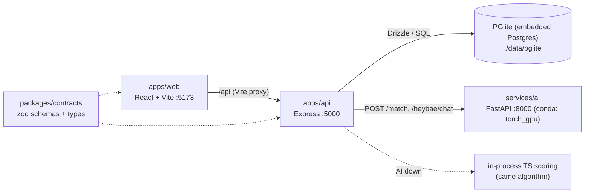

# PodBae Local (PODBAE_AI)

A localhost replica of the PodBae MVP (podbae.love): same pages, flows and API surface.
No Docker, no cloud, **zero API keys needed** (Hey Bae falls back to a deterministic mock).



## Requirements
- Node 20+ (here: the Node inside the `torch_gpu` conda env — run commands from a conda-activated terminal, or make sure `node`/`npm` are on PATH)
- conda env **`torch_gpu`** (Python deps install into it; no venv, no uv)

## Run
Open a terminal where conda works (Anaconda Prompt, or PowerShell after `conda init`):
```powershell
conda activate torch_gpu
cd C:\Nk\PODBAE\podbae-local
npm run setup     # first time only: npm install + pip install into torch_gpu + migrate + seed
npm run dev       # web http://localhost:5173 · api http://localhost:5000 · ai http://localhost:8000
```
Open http://localhost:5173 and log in with a demo account below. Press `Ctrl+C` in the terminal to stop all three servers.

### Stop everything (if servers were left running in the background)
```powershell
foreach ($p in 5173,5000,8000) { Get-NetTCPConnection -LocalPort $p -State Listen -ErrorAction SilentlyContinue | % { Stop-Process -Id $_.OwningProcess -Force } }
```

### Troubleshooting
- **"Invalid email or password"**: check for typos. The admin email is `admin@podbae.local` (ends in `.local`).
- **Port already in use**: run the stop command above, then `npm run dev` again.
- **`node` / `npm` not found**: use the conda-activated terminal. Node is installed inside the `torch_gpu` env.
- **Database errors after stopping uncleanly, or you want a clean slate**: stop all servers, then `npm run reset`.
- **`npm run reset` / `npm run seed` fails or hangs**: the dev servers still hold the database. Stop them first (PGlite allows one process).

| Command | What it does |
|---|---|
| `npm run dev` | starts web, api and ai together |
| `npm run setup` | install deps, apply migrations, seed demo data |
| `npm run reset` | wipe `./data` and reseed (**stop `npm run dev` first** — PGlite allows one process) |
| `npm run db:generate` | generate a new drizzle-kit migration after editing `apps/api/src/db/schema.ts` |
| `npm run db:migrate` / `npm run seed` | apply migrations / seed only |
| `npm run typecheck` · `npm run lint` · `npm run build` | quality checks |
| `npm test` · `npm run test:ai` | API integration tests (vitest + supertest, temp in-memory PGlite) · AI tests (pytest in torch_gpu) |
| `npm run open` | open http://localhost:5173 in your default browser |

## Demo logins (all fake, `demo=true`)
| Email | Password | Role |
|---|---|---|
| admin@podbae.local | admin123 | admin |
| podcaster@podbae.local | demo123 | podcaster (flirt tier) |
| brand@podbae.local | demo123 | advertiser |

Other seeded accounts use `*@demo.podbae.local` / `demo123` (7 more podcasters, 4 advertisers, 4 venues, 5 guests).
Demo accounts "like back" automatically when `DEMO_AUTO_LIKE=true` (set in `.env`), so mutual matches are easy to demo.

## Layer 1: Podcast Intelligence (new)
Real RSS ingestion + a trust-labelled **Podcast Intelligence Profile**, owned by `services/ai` (its own store, `data/intel.db`: SQLite WAL + sqlite-vec; the
Node API and web app reach it **only** through the AI service `/v1` HTTP API).

```powershell
npm run intel:seed             # ingest ~300 real shows (needs internet; see EVAL_LAYER1.md for what this machine could reach)
npm run dev                    # everything
npm run intel:connect-demo     # connects podcaster@podbae.local to a real feed, then open http://localhost:5173/intelligence
npm run test:ai                # pytest: ingestion, trust, LLM-guard and API acceptance tests
```
- **Trust rules (enforced in code + tests):** every stored fact has source, data tier (Verified / Creator-provided / Estimated / AI-inferred), timestamp, confidence; stale data is flagged and refreshed;
  the LLM can never produce ages, genders, incomes, cities or listener counts (schema rejects them); all external text is sanitised and only sent to LLMs inside delimited data blocks; every
  external/LLM/GPU call is in a cost ledger and subject to a budget.
- **Zero keys:** mock LLM + local embeddings (`intfloat/multilingual-e5-small` on your GPU). Optional keys in `.env`: `OPENAI_API_KEY` / `ANTHROPIC_API_KEY`, `PODCASTINDEX_API_KEY` + `PODCASTINDEX_API_SECRET`, `TADDY_USER_ID` + `TADDY_API_KEY` (+ `INTEL_TADDY_ENABLED=true`).
- **Pages:** `/intelligence` (your profile, tier badges, audience CSV upload), `/discover` (real ingested shows), `/admin` (Ingestion jobs / Coverage / Costs tabs).
- **Reports:** `LAYER1_REPORT.md` (what works, mocked parts, risks, seams for Layer 2 and 4), `EVAL_LAYER1.md` (measured numbers).
- **Postgres in production:** set `INTEL_DATABASE_URL=postgresql+psycopg://…` and `INTEL_VECTOR_BACKEND=pgvector` (code path written but not exercised locally).

## Optional keys
`OPENAI_API_KEY` or `ANTHROPIC_API_KEY` in `.env` (plus `LLM_PROVIDER=openai|anthropic`) only change Hey Bae replies. Matching never uses an LLM.

## Folder map (inside `podbae-local/`)
```
packages/contracts/   zod schemas, vocabularies, tier config (shared by web + api)
apps/api/
  drizzle/            generated SQL migrations (from src/db/schema.ts — the single source of truth)
  src/db/             PGlite client, schema, session store, migrate + seed
  src/routes/         auth, intake, podcasts(+public/search), member, social(chat/heybae/campaigns/schedule), admin
  src/services/       matching, scoring (TS fallback), ai client, tiers/quota, payments (PaymentProvider seam)
  tests/              vitest + supertest
apps/web/src/         pages/, components/ (shadcn-style on Radix), lib/
services/ai/          FastAPI placeholder matcher + Hey Bae (requirements.txt, weights.yaml, tests/)
data/pglite/          the database files (git-ignored)
```

## Notes
- Placeholder AI only: weighted tag-overlap scoring + templated explanations. No ingestion, embeddings or agent tools yet. The pgvector extension is enabled in PGlite for later.
- Checkout is a mock page (`/mock-checkout`) behind a `PaymentProvider` interface; "paying" upgrades the tier locally.
- Anything shown to users comes from a DB row; seeded rows are flagged `demo` and have provenance rows in `data_sources`.
