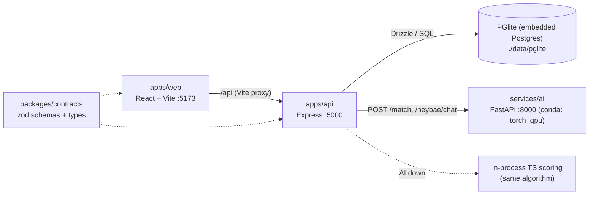

# PodBae Local

A localhost replica of the PodBae MVP (podbae.love): same pages, flows and API surface.
No Docker, no cloud, **zero API keys needed** (Hey Bae falls back to a deterministic mock).



## Requirements
- Node 20+ (here: the Node inside the `torch_gpu` conda env — run commands from a conda-activated terminal, or make sure `node`/`npm` are on PATH)
- conda env **`torch_gpu`** (Python deps install into it; no venv, no uv)

## Run
```bash
npm run setup     # npm install + pip install into torch_gpu + migrate + seed
npm run dev       # web http://localhost:5173 · api http://localhost:5000 · ai http://localhost:8000
```

| Command | What it does |
|---|---|
| `npm run dev` | starts web, api and ai together |
| `npm run setup` | install deps, apply migrations, seed demo data |
| `npm run reset` | wipe `./data` and reseed (**stop `npm run dev` first** — PGlite allows one process) |
| `npm run db:generate` | generate a new drizzle-kit migration after editing `apps/api/src/db/schema.ts` |
| `npm run db:migrate` / `npm run seed` | apply migrations / seed only |
| `npm run typecheck` · `npm run lint` · `npm run build` | quality checks |
| `npm test` · `npm run test:ai` | API integration tests (vitest + supertest, temp in-memory PGlite) · AI tests (pytest in torch_gpu) |
| `npm run open` | open http://localhost:5173 in your default browser |

## Demo logins (all fake, `demo=true`)
| Email | Password | Role |
|---|---|---|
| admin@podbae.local | admin123 | admin |
| podcaster@podbae.local | demo123 | podcaster (flirt tier) |
| brand@podbae.local | demo123 | advertiser |

Other seeded accounts use `*@demo.podbae.local` / `demo123` (7 more podcasters, 4 advertisers, 4 venues, 5 guests).
Demo accounts "like back" automatically when `DEMO_AUTO_LIKE=true` (set in `.env`), so mutual matches are easy to demo.

## Optional keys
`OPENAI_API_KEY` or `ANTHROPIC_API_KEY` in `.env` (plus `LLM_PROVIDER=openai|anthropic`) only change Hey Bae replies. Matching never uses an LLM.

## Folder map
```
packages/contracts/   zod schemas, vocabularies, tier config (shared by web + api)
apps/api/
  drizzle/            generated SQL migrations (from src/db/schema.ts — the single source of truth)
  src/db/             PGlite client, schema, session store, migrate + seed
  src/routes/         auth, intake, podcasts(+public/search), member, social(chat/heybae/campaigns/schedule), admin
  src/services/       matching, scoring (TS fallback), ai client, tiers/quota, payments (PaymentProvider seam)
  tests/              vitest + supertest
apps/web/src/         pages/, components/ (shadcn-style on Radix), lib/
services/ai/          FastAPI placeholder matcher + Hey Bae (requirements.txt, weights.yaml, tests/)
data/pglite/          the database files (git-ignored)
```

## Notes
- Placeholder AI only: weighted tag-overlap scoring + templated explanations. No ingestion, embeddings or agent tools yet. The pgvector extension is enabled in PGlite for later.
- Checkout is a mock page (`/mock-checkout`) behind a `PaymentProvider` interface; "paying" upgrades the tier locally.
- Anything shown to users comes from a DB row; seeded rows are flagged `demo` and have provenance rows in `data_sources`.
